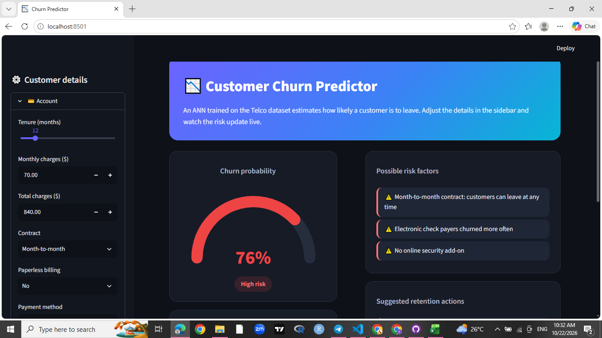

# 📉 Customer Churn Prediction with an ANN

An artificial neural network (ANN) that predicts whether a telecom customer is likely to leave, deployed as an interactive Streamlit web app.



## Problem

Keeping an existing customer is cheaper than winning a new one. If a company can identify customers who are about to leave (churn), it can step in early with discounts, better contracts or support. This project builds a model that estimates each customer's churn probability.

## Dataset

[Telco Customer Churn](https://www.kaggle.com/datasets/blastchar/telco-customer-churn) (Kaggle, IBM sample data): 7,043 customers, 20 features covering account information, services and demographics. About 26% of customers churned, so the classes are imbalanced.

## Approach

1. **Cleaning**: converted `TotalCharges` to numeric, dropped 11 rows with missing values and removed `customerID`.
2. **Encoding**: one-hot encoding of categorical features (30 input features in total).
3. **Split and scaling**: stratified 80/20 train/test split; `StandardScaler` fitted on the training set only to avoid data leakage.
4. **Imbalance**: used class weights so the model pays more attention to churners.
5. **Models**: Logistic Regression (baseline), Random Forest, Gradient Boosting and an ANN.
6. **ANN architecture**: Dense(32, ReLU) → Dropout(0.3) → Dense(16, ReLU) → Dropout(0.3) → Dense(1, sigmoid); Adam optimizer, binary cross-entropy loss, early stopping.

## Results

Test set of 1,407 customers:

| Model | ROC-AUC | Churn precision | Churn recall | Churn F1 |
|---|---|---|---|---|
| Gradient Boosting | **0.841** | - | - | - |
| Logistic Regression | 0.835 | 0.49 | 0.80 | 0.61 |
| ANN | 0.831 | 0.50 | 0.79 | 0.61 |
| Random Forest | 0.820 | - | - | - |

**Takeaways**

- On this tabular dataset the ANN performs about the same as simple models. The differences in ROC-AUC are small, so a deep model is not automatically better for tabular data.
- Accuracy alone is misleading with imbalanced data (always predicting "no churn" gives about 74%), so recall, F1 and ROC-AUC were used instead.
- The ANN catches about 79% of the customers who actually churn, at the cost of lower precision (about 50%), a trade-off created by the class weights.

## Key churn drivers

From the Random Forest feature importances:

- Shorter **tenure** and higher **monthly charges**
- **Month-to-month** contracts (longer contracts retain customers)
- **Fiber optic** internet and **electronic check** payments
- Customers without **online security** add-ons

Possible actions: encourage longer contracts, offer security/support add-ons, and review the Fiber optic experience.

## Run the app locally

```bash
git clone https://github.com/<your-username>/churn-prediction-ann.git
cd churn-prediction-ann
pip install -r requirements.txt
streamlit run app.py
```

## Project structure

```
├── app.py                  # Streamlit app
├── churn.ipynb             # EDA, preprocessing, model training and comparison
├── churn_ann.keras         # trained ANN
├── scaler.pkl              # fitted StandardScaler
├── columns.json            # feature order used by the model
├── requirements.txt
└── .streamlit/config.toml  # dark theme
```

## Tech stack

Python, pandas, NumPy, scikit-learn, TensorFlow/Keras, Streamlit

## Limitations

- Single dataset from one telecom company; results may not transfer to other businesses.
- The risk factors and retention suggestions in the app are simple rules based on patterns in the data, not model explanations.
- For learning and portfolio use only.
